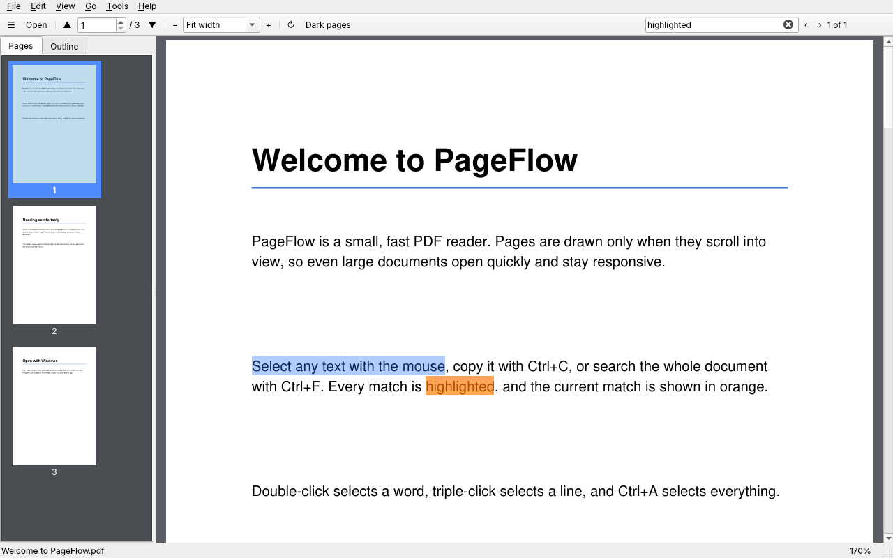
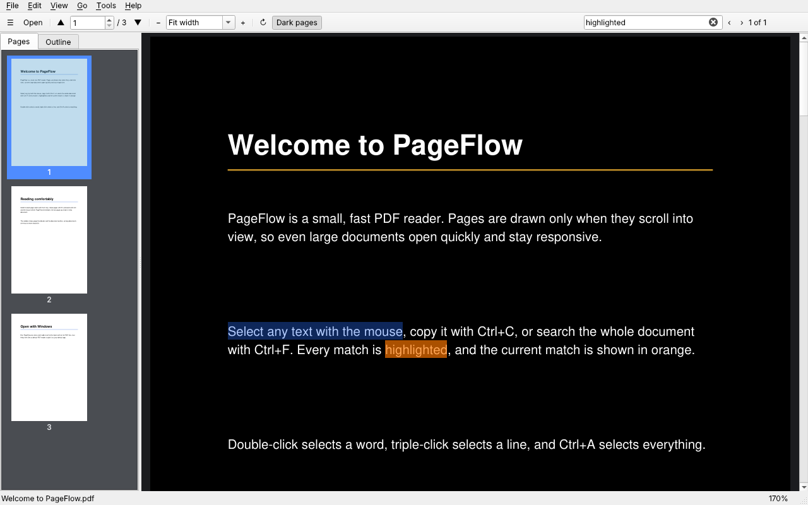

# PageFlow

[](https://github.com/labgreeks-ai/PageFlow/actions/workflows/tests.yml)


A lightweight, free PDF reader. Opens quickly, lets you select and copy text, and registers itself in Windows' **Open with** list.

**Created by Amman** - [github.com/labgreeks-ai](https://github.com/labgreeks-ai)



<details>
<summary>Dark pages</summary>



</details>

## Features

- **Select and copy text** with the mouse: drag, double-click a word, triple-click a line, `Ctrl+A` for everything, `Ctrl+C` to copy. Right-click for a menu that can also search for the selected text.
- **Search** (`Ctrl+F`) with every match highlighted and the current one in orange
- Continuous scrolling; only the pages you can see are drawn, so large files stay light
- Zoom: fit width, fit page, presets, typed values, `Ctrl` + mouse wheel
- Rotate pages, **dark page colors** (remembered), password-protected PDFs
- Sidebar with page thumbnails and the document outline (bookmarks)
- Remembers the last page of every file, plus a recent files list
- Drag and drop a PDF onto the window, or pass one on the command line
- Save a copy with the current rotation, copy the text of a page, save a page as a PNG
- **Windows:** adds itself to the "Open with" list and to Settings > Default apps

## Download (Windows)

Get `PageFlow.exe` from the [Releases](https://github.com/labgreeks-ai/PageFlow/releases) page. It is a single file; no Python is needed to run it.

The exe is not code-signed, so Windows SmartScreen may say "Windows protected your PC" the first time. Click **More info**, then **Run anyway**. Each release also has a `PageFlow.exe.sha256` file so you can check the download:

```
certutil -hashfile PageFlow.exe SHA256
```

## Use PageFlow to open your PDFs

1. Put `PageFlow.exe` in a folder it can stay in, for example `C:\PageFlow\`.
2. Double-click it once. On start-up it adds itself to Windows' **Open with** list for PDF files and to Settings > Apps > Default apps. No administrator rights are needed; the entries are stored for your user only.
3. Right-click any PDF > **Open with** > **PageFlow**.
4. To make it the default, choose **Help > Set as default PDF reader...** (it opens the Windows Settings page for you), or right-click a PDF > Open with > Choose another app > PageFlow > tick **Always**. Windows does not let a program make itself the default silently, so this one choice is yours.

If you move the exe, run it once from the new place and it updates the entries. **Help > Remove PDF file association entries** removes everything again, and PageFlow then stops re-adding itself. The same switches work from a command prompt: `PageFlow.exe --register` and `PageFlow.exe --unregister`.

## Run from source

You need Python (3.11 to 3.13 is the safest choice).

```
pip install -r requirements.txt
python pageflow.py
```

To open a file directly: `python pageflow.py "C:\path\to\file.pdf"`

## Build the Windows exe yourself

**On GitHub (no Python needed on your PC):** push a version tag and the *Build Windows exe* workflow builds `PageFlow.exe`, runs a quick check of the Windows registration code on a real Windows machine, and attaches the exe and its checksum to a new release.

```
git tag v1.1.0
git push origin v1.1.0
```

You can also start the workflow by hand from the **Actions** tab and download the exe from the run page.

**On your own PC:** install 64-bit Python from [python.org](https://www.python.org) (tick "Add python.exe to PATH") and double-click **build.bat**. The exe appears in `dist\PageFlow.exe`. The script works in its own environment in `C:\PageFlowBuild`, which avoids the Windows 260-character path problem seen with the Microsoft Store version of Python.

## Keyboard shortcuts

| Key | Action |
| --- | --- |
| `Ctrl+O` | Open |
| `Ctrl+C` / `Ctrl+A` / `Esc` | Copy selected text / select all text / clear the selection |
| `Ctrl+F`, `F3`, `Shift+F3` | Search, next match, previous match |
| `Ctrl +` / `Ctrl -` / `Ctrl+0` / `Ctrl+9` / `Ctrl+1` | Zoom in / out / fit width / fit page / actual size |
| `Left` / `Right` | Previous / next page (when the page fits horizontally) |
| `Home` / `End` | First / last page |
| `Ctrl+G` | Go to page |
| `R` | Rotate |
| `D` | Dark pages |
| `F4` | Show or hide the sidebar |
| `Ctrl+Shift+C` | Copy the text of the current page |
| `Ctrl+Shift+S` | Save a copy |

## Project layout

| Path | What it is |
| --- | --- |
| `pageflow.py` | The application: window, viewer, search, text selection |
| `winassoc.py` | Windows "Open with" and default-app registration |
| `icon.png`, `icon.ico` | App icon |
| `build.bat`, `version_info.txt` | Local Windows exe build and the version details embedded in the exe |
| `tests/` | Headless tests (`python tests/test_reader.py`, `python tests/test_selection.py`) |
| `tools/make_screenshots.py` | Regenerates the screenshots in `docs/` from the real app |
| `.github/workflows/` | Tests on every push; Windows exe build on version tags |

## Known limits

- Scanned PDFs have no text layer, so selecting, search and copy find nothing in them (PageFlow tells you when a page has no text).
- Text selection follows the order the PDF stores its text in. In multi-column layouts a drag across columns can pick up text in an odd order.
- Pages are drawn on the main thread, so a very heavy page can pause scrolling briefly.
- The single-file exe unpacks itself on every launch, so the first window can take a few seconds to appear.
- PageFlow only reads PDFs; it does not edit them (apart from saving a rotated copy).

## Credits

PageFlow was created by **Amman** ([@labgreeks-ai](https://github.com/labgreeks-ai)).

It stands on excellent open source work: **PyMuPDF** and **MuPDF** by Artifex Software draw the pages and extract the text, **PySide6 / Qt** provides the interface, and **PyInstaller** builds the exe. See [CREDITS.md](CREDITS.md) for the full list and licences.

## License

PageFlow is free software, released under the **GNU Affero General Public License v3.0** (see [LICENSE](LICENSE)). This licence is used because PageFlow is built on PyMuPDF, which is itself AGPL-3.0 (Artifex also sells a commercial licence). In short: you may use, study, change and share PageFlow, and if you distribute it, or a modified version, you must make the source code available under the same licence. This is a summary, not legal advice.

Copyright (C) 2026 Amman
